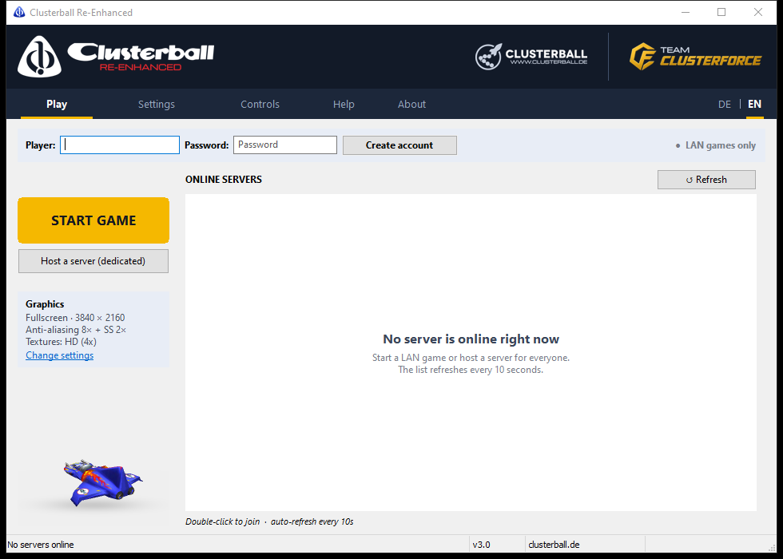
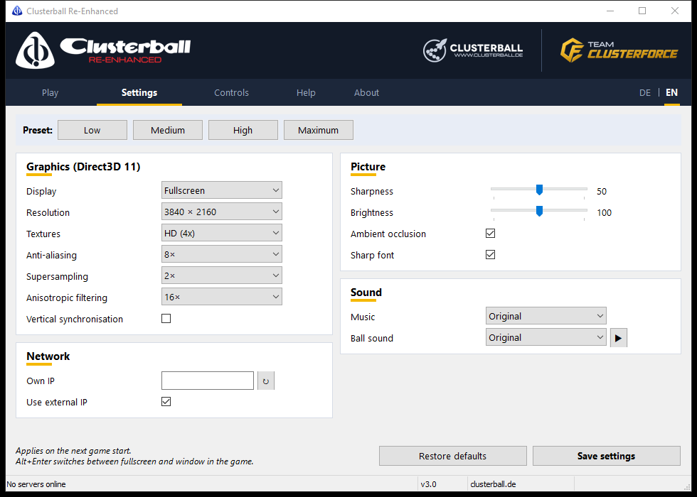
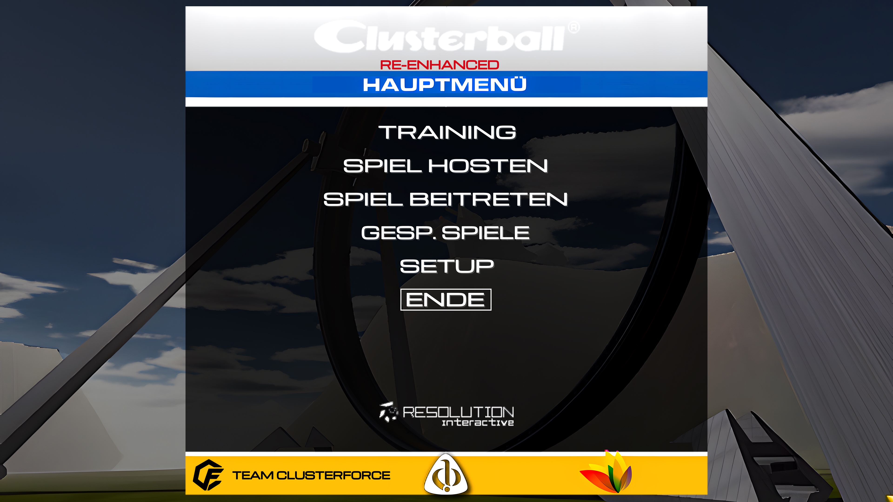
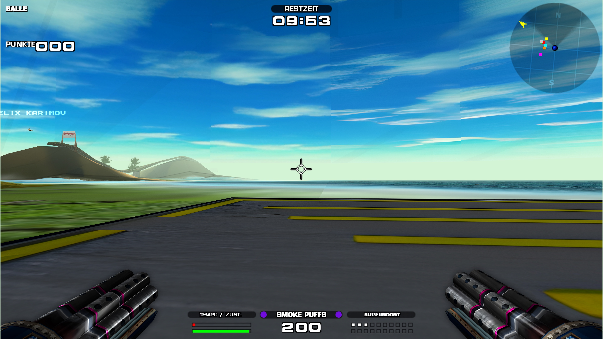
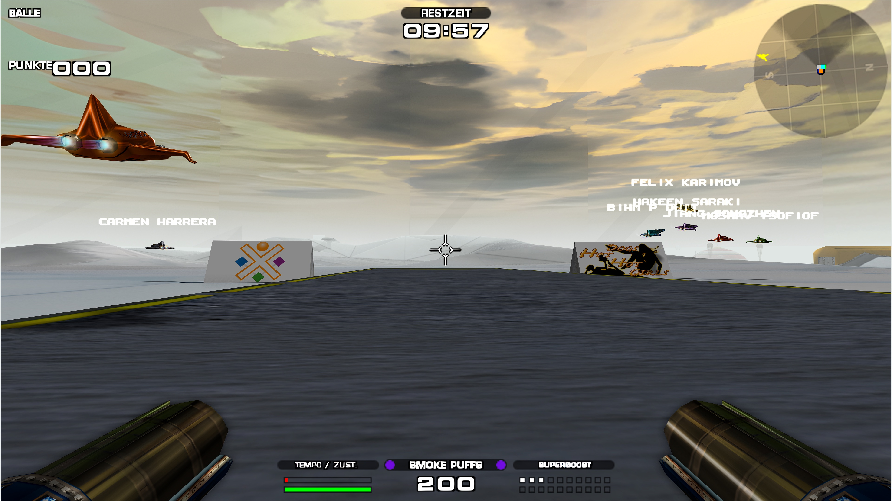
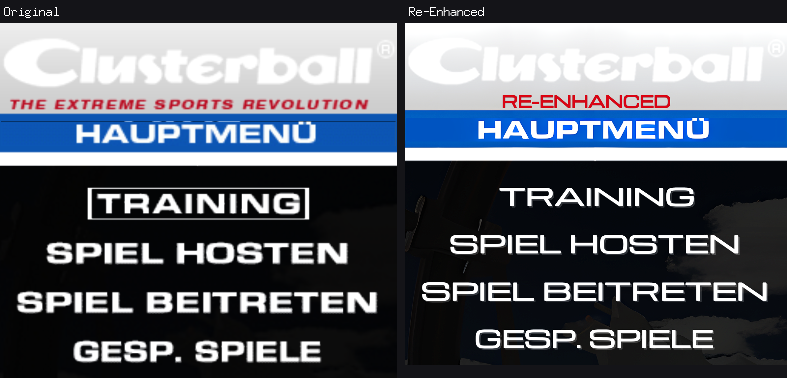
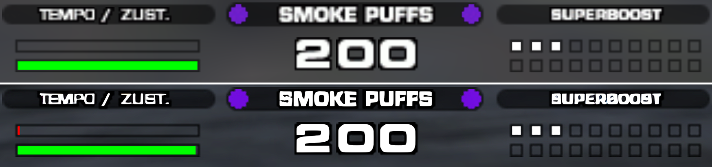

Clusterball (Daydream Software, 2000) is a fast sport in the air: you fly a
glider through a landscape, collect coloured balls into a chain behind you and
fly that chain through the ring in the arena - while up to seven other pilots
try to shoot it apart or steal it. The game still has a loyal community at
[clusterball.de](https://www.clusterball.de), but on today's PCs it barely
runs any more.

**Clusterball Re-Enhanced** makes it playable again - without changing the
game:

- sharp at your monitor's native resolution, up to 4K, with smooth edges and
  high-resolution textures
- crisp menu and HUD text
- a new launcher with the server list, graphics settings, key bindings
  (WASD + mouse, mouse wheel) and the game's manual built in, in English and
  German
- online play via clusterball.de
- optionally music and ball sounds from ClusterForce instead of the originals

Gameplay, flight model, weapons and worlds stay exactly as they were; the
original music and sounds stay too unless you switch them.

Made by Team ClusterForce, who are also working on
[ClusterForce](https://store.steampowered.com/app/5063650/), a spiritual
successor to Clusterball.

## Screenshots

### The launcher

 &nbsp; 

### The game

All game screenshots on this page are unscaled frames at 3840 × 2160 with the
highest settings, saved as JPEG at quality 95. Click one to see it at full
size.

## Getting started

Put `ClusterballCC.exe` into your Clusterball folder, next to
`Clusterball.exe`, and start it. It sets everything else up when you start the
game; the details are under [Installation](#installation).

---

## Under the hood

The rest of this page is for those who want to know how it works or build it
themselves.

## A native Direct3D 11 renderer

Clusterball was written for 3dfx Glide and OpenGL. Until now it ran on today's
PCs through nGlide (a Glide wrapper), Mesa or the graphics driver's legacy
OpenGL path - all of them pass the game's drawing on call by call and have to
take the picture exactly as the game hands it over, in its fixed low
resolution.

Re-Enhanced replaces the graphics library itself. `Clusterball.exe` loads a
library named `opengl32.dll` from its own folder; ours implements the OpenGL
subset the game uses directly on Direct3D 11. There is no translation layer
underneath, no Glide and no OpenGL driver involved - one DLL of about 450 KB
that uses only Windows' own Direct3D 11 and DXGI.

Because it sits exactly where the game draws, it does what a wrapper cannot:

- **Any resolution:** renders at any size up to 4K and beyond, independent of
  the game's fixed 640 × 480 OpenGL mode; the game's layout stays as it was
- **Anti-aliasing and filtering:** MSAA up to 8×, supersampling, anisotropic
  filtering up to 16×, sharpening, colour grading and optional ambient
  occlusion from the depth buffer
- **High-resolution textures:** every texture is recognised by a hash of its
  pixels and replaced from a texture pack (4× or 16× the original size) -
  including the pictures the game composes at run time and the parts of its
  text texture, such as menu titles, tab labels and "LADE ..."
- **Sharp text:** the 8 × 8 pixel menu and HUD font is replaced by a
  high-resolution atlas, drawn with cells of twice the height so accents and
  descenders fit
- **Clean 2D:** menu pictures are sampled only inside their own rectangle - no
  seams, stripes or colour-key lines at their edges
- **Modern presentation:** DXGI flip model, borderless fullscreen at the
  monitor's native resolution without a mode switch, window mode, and
  Alt+Enter to switch while playing
- **Replacement audio:** with `MusicDir` the music the game streams through
  BASS (`Levels\<venue>.mp3`, `MUSIC\Intro.mp3`/`Outro.mp3`) comes from another
  folder, with `DataArchive` the game opens a copy of `Data.mrg` (the launcher
  builds one with other ball sounds); the original files stay untouched
- **Mouse wheel:** the game has no wheel binding; the renderer turns each notch
  into a short press of a key (the launcher uses F11/F12), so it can put
  actions such as switching weapons on the wheel
- **Fixes around the picture:** mouse via DirectInput with the Windows pointer
  speed, no self-minimising, no crash on the game's display-mode probing
  (uninitialised `DEVMODE`, 16-bit modes, oversized texture probe)
- **Honest settings in the game:** Setup - System shows "Direct3D 11" and the
  resolution actually rendered; the old renderer and resolution choices there
  can no longer switch the game back to Glide or 640 × 480 or restart it

"Before" is the same game at the same size with the texture pack, the font
replacement, anti-aliasing and post-processing switched off - the way the
original renders. The screenshots use the highest settings: 8× MSAA, 2×
supersampling, 16× anisotropic filtering, ambient occlusion and the 16×
texture pack; the before/after crops are lossless PNG.

All settings live in `clusterball_d3d.ini` next to `Clusterball.exe`; the
launcher writes it, and the template with every key and its meaning is
[launcher/layer/clusterball_d3d.ini](launcher/layer/clusterball_d3d.ini).
An environment variable `CB_<NAME>` overrides a value (e.g. `CB_RES=1920x1080`).

## Repository

The repository has two main parts, plus the scripts for the texture packs and
the development tools:

- [modern-renderer/](modern-renderer/) - the **Direct3D 11 renderer**
  (`opengl32.dll`, see above)
- [launcher/](launcher/) - the launcher **Command Center**
  (`ClusterballCC.exe`). It brings the renderer along, installs it next to the
  game and configures it.
- [assets/](assets/) - scripts that build the texture packs and redraw the
  menu text (see [Texture packs](#texture-packs)).
- [tools/](tools/) - development tools: call tracer, analysis programs and
  the renderer's test scripts (see [Development tools](#development-tools)).

## Command Center

The launcher replaces the outdated XDream Command Center (XDreamCC) that
originally shipped with the game. XDreamCC relies on XDream services that
were shut down long ago; the Command Center takes over all of its duties and
replaces the old `XDreamCC.ini`. Screenshots are at the
[top of this page](#the-launcher).

### Features

- Server list from the clusterball.de master server, with automatic refresh
  and join on double-click
- Game launch that carries account credentials and settings into the game's
  `config.cfg` and prepares the game folder: installs the renderer, writes
  its settings, generates the sharp font and removes the old Glide files;
  `Clusterball.exe` gets the Re-Enhanced icon (only its icon resources
  change, checked against the original before the file is replaced)
- Dedicated host launch including the UDP heartbeat that registers the host
  with the master server (protocol reconstructed via reverse engineering)
- Graphics settings: fullscreen or window, resolution, anti-aliasing,
  supersampling, anisotropic filtering, texture pack, sharpness, VSync, sharp
  font, ambient occlusion; brightness and mouse sensitivity (the game's detail
  level is always set to High)
- Controls: key bindings with drawn keys and mouse symbols, presets
  "WASD + mouse" (default) and "Classic", any key, mouse button or the mouse
  wheel per action; written to the game's `config.cfg` in its own key names
- Detection of the own external IP for hosting
- Sound: music from ClusterForce instead of the game's (the song of the
  ClusterForce teaser in the menus, a 30-second excerpt matching each venue)
  and the announcer's "Ball" in one of ClusterForce's three variants -
  Standard, Board computer, Announcer - or the original; built by
  `assets\build_cf_audio.ps1` from the ClusterForce masters
- Help: the game-related part of the manual from clusterball.de, built in
  (German and English); About: what Re-Enhanced is and its successor
  ClusterForce
- User interface in German and English: follows the Windows language on the
  first start, DE | EN switch in the tab bar

### Installation

Copy `ClusterballCC.exe` into the game folder, next to `Clusterball.exe`, and
start it. There is nothing to point it to: it always uses the
`Clusterball.exe` next to itself. Its own configuration is stored there as
well (`clusterball.ini`; an `xdreamcc.cfg` of earlier versions is taken over
and removed on the first save).

The game folder needs only `Clusterball.exe` (with its `.manifest`),
`Data.mrg`, `Local.mrg`, `Bass.dll`, `a3d.dll`, `a3dapi.dll`, `config.cfg`
and the folders `Levels`, `Music`, `Skins` and `Misc`. Texture packs are
optional: place them as `textures\hd` (4x) and `textures\hd16` (16x) and
choose them under Settings - Textures.

### Command line

| Flag | Effect |
| ---- | ------ |
| `-d` | starts as a dedicated host without a UI (including heartbeat) |
| `-g` | starts the game directly, without the launcher window |

Without flags the graphical user interface opens.

## Building

Requirements: Go 1.26 or newer, Windows (the UI is based on the Win32
library walk), and [Zig](https://ziglang.org) 0.17 for the renderer.

    build.cmd [output directory]

This builds the renderer (`modern-renderer\` into `launcher\layer\opengl32.dll`,
which the Command Center embeds) and `ClusterballCC.exe` into the output
directory, `_release` by default. Without Zig the committed
`launcher\layer\opengl32.dll` is used. To build the renderer manually:

    cd modern-renderer
    zig cc -target x86-windows-gnu -shared -O2 -o opengl32.dll gld3d.c pass.c compat.c appicon.c -ld3d11 -ldxgi -ldxguid -lgdi32 -luser32

`pass.c` (pass-through stubs for the exports of `opengl32.dll` the game
never calls, needed because GLU32.dll binds to the file by name) is generated
by `modern-renderer\gen` from the system's `opengl32.dll`.

### Tests

    cd launcher
    go test ./...

## Texture packs

The packs are made from the game's own textures and are therefore not part
of this repository. The scripts in [assets/](assets/) build them:

1. `assets\dump_all_menus.ps1 -GameDir <game folder>` plays through every
   menu, a LAN match and a training with `TextureDump=1`; repeat with
   `-English` for the English texts. Textures land in `textures\dump`, the
   ones drawn in 2D are listed in `textures\ui_textures.txt`.
2. `assets\build_texture_pack.ps1 -GameDir <game folder> -Hd16` upscales them
   with Real-ESRGAN and compresses them to BC7 (`textures\hd`, `textures\hd16`).
3. `assets\build_ui_pack.ps1 -GameDir <game folder> -Hd16` rebuilds the 2D
   textures, choosing per texture between the models for drawn art and
   photos (`assets\cmd\pickmodel`).
4. `assets\brand_pack.ps1 -GameDir <game folder>` adds the Clusterball
   Re-Enhanced and Team ClusterForce marks to the menu header, the menu bar
   and the loading box and redraws the menu words and the game menu's tab
   labels sharp (`assets\cmd\brand`, with the Michroma font under the
   SIL Open Font License).

`assets\build_scaled_pack.ps1 -GameDir <game folder> -List <hashes.txt>
-Factor 8 -Cap 2048 -Name hd8` builds a pack for a list of textures at another
size, resampled from the 4x and 16x upscales (`assets\cmd\scalepack`). It is
not used by the game; ClusterForce takes it for the textures of the ported
Clusterball levels.

Third-party programs go into `assets\bin` (not in the repository):
[Real-ESRGAN ncnn Vulkan](https://github.com/xinntao/Real-ESRGAN/releases)
as `assets\bin\esrgan\` (with its `models` folder) and
[texconv](https://github.com/microsoft/DirectXTex/releases) as
`assets\bin\texconv.exe`.

## Development tools

[tools/](tools/) holds what was used to get there: the OpenGL call tracer, the
former Glide stub, small analysis programs and the renderer's test scripts.
See [tools/README.md](tools/README.md).

## Dependencies

| Module | Purpose | License |
| ------ | ------- | ------- |
| [github.com/lxn/walk](https://github.com/lxn/walk) | Win32 GUI library | BSD-3-Clause |
| [github.com/lxn/win](https://github.com/lxn/win) | Win32 API bindings (used by walk) | BSD-3-Clause |
| [golang.org/x/image](https://pkg.go.dev/golang.org/x/image) | Font rendering for the sharp font | BSD-3-Clause |
| [golang.org/x/text](https://pkg.go.dev/golang.org/x/text) | Character maps (used by x/image) | BSD-3-Clause |
| [golang.org/x/sys](https://pkg.go.dev/golang.org/x/sys) | System calls (used by walk) | BSD-3-Clause |
| [golang.org/x/arch](https://pkg.go.dev/golang.org/x/arch) | x86 disassembler of the analysis tools in `tools/` | BSD-3-Clause |
| [gopkg.in/Knetic/govaluate.v3](https://github.com/Knetic/govaluate) | Expression evaluation (used by walk) | MIT |

The renderer uses only Windows system libraries (Direct3D 11, DXGI, the
shader compiler `d3dcompiler_47.dll`).

## License

This project is licensed under the [Apache License 2.0](LICENSE); read it
together with [NOTICE](NOTICE). In short:

- You may use, copy, change and pass on the code, also in your own projects -
  as long as the [NOTICE](NOTICE) file with everyone involved goes with it and
  changed files are marked as changed.
- A modified version must not be published as "Clusterball Re-Enhanced" or
  under the names or logos of Team ClusterForce. Saying that your work is
  based on Clusterball Re-Enhanced by Team ClusterForce is welcome; anything
  more needs our written permission.

All included modules use permissive licenses (BSD-3-Clause or MIT) that are
compatible with the Apache License; their license texts ship with the
respective modules.

Clusterball itself is a product of Daydream Software. This project is not
affiliated with the original rights holders.
