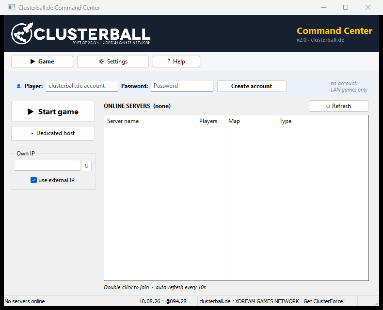

# Classic Clusterball

Tools and infrastructure to make the game Clusterball (Daydream Software, 2000)
playable again on modern systems and online via
[clusterball.de](http://www.clusterball.de).

## Command Center

The [commandcenter/](commandcenter/) directory contains the launcher
"Clusterball.de Command Center" - a replacement for the outdated XDream
Command Center (XDreamCC) that originally shipped with the game. XDreamCC
relies on XDream services that were shut down long ago and only runs with
limitations on current Windows versions. The Command Center takes over all of
its duties and replaces the old `XDreamCC.ini`; an existing configuration is
no longer required.

### Features

- Server list from the clusterball.de master server, with automatic refresh
  and join on double-click
- Game launch that carries account credentials and graphics settings over
  into the game's `config.cfg`
- Dedicated host launch including the UDP heartbeat that registers the host
  with the master server (protocol reconstructed via reverse engineering)
- Configuration of renderer (3dfx/Glide, Direct3D, OpenGL, software), image
  quality, brightness and texture options
- Control of the Glide wrapper nGlide via environment variables (render
  resolution, aspect ratio, VSync), allowing the game to render above its
  native 1024 x 768
- Detection of the own external IP for hosting
- User interface in German and English, switchable at runtime

### Command line

| Flag | Effect |
| ---- | ------ |
| `-d` | starts as a dedicated host without a UI (including heartbeat) |
| `-g` | starts the game directly, without the launcher window |

Without flags the graphical user interface opens.

### Building

Requirements: Go 1.26 or newer, Windows (the UI is based on the Win32 library
walk).

    build.cmd

This builds `ClusterballCC.exe` into the `_release` directory. To build
manually:

    cd commandcenter
    go build -ldflags="-H windowsgui" -o ClusterballCC.exe

The file `ClusterballCC.syso` automatically embeds the icon and application
manifest during the build. The finished `ClusterballCC.exe` belongs in the
game directory next to `Clusterball.exe`; that is also where it stores its
configuration (`xdreamcc.cfg`).

### Tests

    cd commandcenter
    go test ./...

### Dependencies

| Module | Purpose | License |
| ------ | ------- | ------- |
| [github.com/lxn/walk](https://github.com/lxn/walk) | Win32 GUI library | BSD-3-Clause |
| [github.com/lxn/win](https://github.com/lxn/win) | Win32 API bindings (used by walk) | BSD-3-Clause |
| [golang.org/x/sys](https://pkg.go.dev/golang.org/x/sys) | System calls (used by walk) | BSD-3-Clause |
| [gopkg.in/Knetic/govaluate.v3](https://github.com/Knetic/govaluate) | Expression evaluation (used by walk) | MIT |

## License

This project is licensed under the [Apache License 2.0](LICENSE); read it
together with [NOTICE](NOTICE). In short:

- You may use, copy, change and pass on the code, also in your own projects -
  as long as the [NOTICE](NOTICE) file with everyone involved goes with it and
  changed files are marked as changed.
- A modified version must not be published as "Clusterball Re-Enhanced" or
  under the names or logos of Team ClusterForce. Saying that your work is
  based on Clusterball Re-Enhanced by Team ClusterForce is welcome; anything
  more needs our written permission.

All included modules use permissive licenses (BSD-3-Clause or MIT) that are
compatible with the Apache License; their license texts ship with the
respective modules.

Clusterball itself is a product of Daydream Software. This repository contains no
game files and is not affiliated with the original rights holders.
